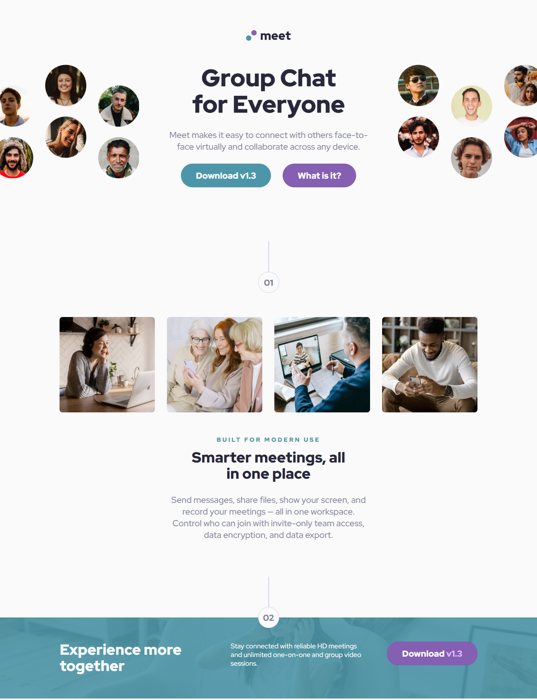
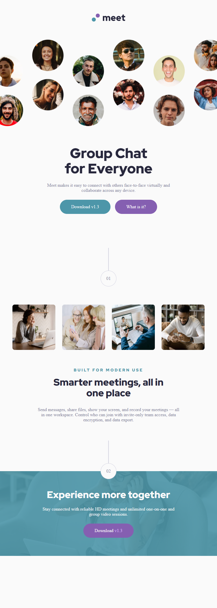

# Frontend Mentor - Meet landing page solution

This is a solution to the [Meet landing page challenge on Frontend Mentor](https://www.frontendmentor.io/challenges/meet-landing-page-rbTDS6OUR). Frontend Mentor challenges help you improve your coding skills by building realistic projects. 

## Table of contents

- [Frontend Mentor - Meet landing page solution](#frontend-mentor---meet-landing-page-solution)
	- [Table of contents](#table-of-contents)
	- [Overview](#overview)
		- [The challenge](#the-challenge)
		- [Screenshot](#screenshot)
		- [Links](#links)
	- [My process](#my-process)
		- [Built with](#built-with)
		- [What I learned](#what-i-learned)
		- [Useful resources](#useful-resources)
	- [Author](#author)

## Overview
This challenge was to build a responsive sample landing page with a couple of call-to-action buttons and additional information available by scrolling down. The buttons also needed hover and active states. This is another challenge I ended up rebuilding and refactoring after initially completing it.

The first time I built it, I took a mobile-first approach without reviewing what the tablet and desktop layouts would require. As a result, I ended up with long, complicated sections under each media query. Looking back, it was hard to distinguish between repeated styles and adjustments from one hard-coded value, such as a font size, to another.

I revisited the project and made a few changes. First, rather than defining every changing value at each viewport size, I introduced scaling values. The results don't always match the design exactly, but I felt they looked better, particularly at viewport widths above 1440 pixels.

I also switched from Sass variables to CSS custom properties, which allowed me to use locally scoped variables that I could adjust within media queries. I kept the Sass mixins but updated them to use scaling font sizes. This gave me a single set of typography presets that covered everything I needed, reducing the need for custom styling within media queries.

Ultimately, the SCSS file didn't get significantly smaller, but I think it became much easier to read, with nested styles, greater use of the cascade, and fewer media-query overrides.

### The challenge

Users should be able to:

- View the optimal layout depending on their device's screen size
- See hover states for interactive elements

### Screenshot

- Desktop View 
- Desktop View with Header CTA Active 
- Tablet View  
  
- Mobile View  
  

### Links

- Solution URL: [https://github.com/kkanit22/FEM-2-4-meet-landing-page](https://github.com/kkanit22/FEM-2-4-meet-landing-page)
- Live Site URL: [https://kkanit22.github.io/FEM-2-4-meet-landing-page/](https://kkanit22.github.io/FEM-2-4-meet-landing-page/)

## My process

### Built with

- Semantic HTML5 markup
- CSS custom properties
- Flexbox
- Mobile-first workflow
- [SASS](https://sass-lang.com/) - Syntactically Awesome Style Sheets, a CSS preprocessor

### What I learned

I have used SASS before, but it has been more than a few years so the refresher was nice. I also learned that while SASS offers some great advantages in writing readable and easy to find css code, as a preprocessor it has some limitations. For example, it cannot assign a new value to locally scoped variables in media queries. As a result I will continue to use SASS in some projects, but will likely focus on the @mixins (style blocks for reusable style elements that can incorporate locally scoped variables) and nested styles which make it easier to find styles applied to an element based on the DOM tree.

### Useful resources

- [SASS homepage](https://sass-lang.com/) - A great resource for seting up and using SASS. 

## Author

- Frontend Mentor - [@kkanit22](https://www.frontendmentor.io/profile/kkanit22)